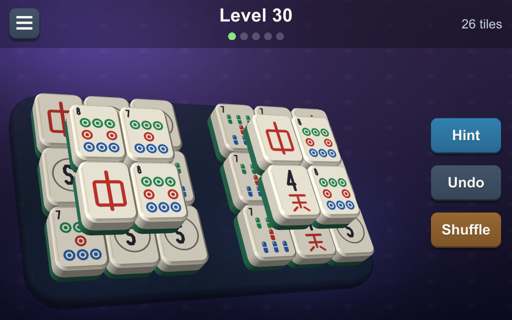
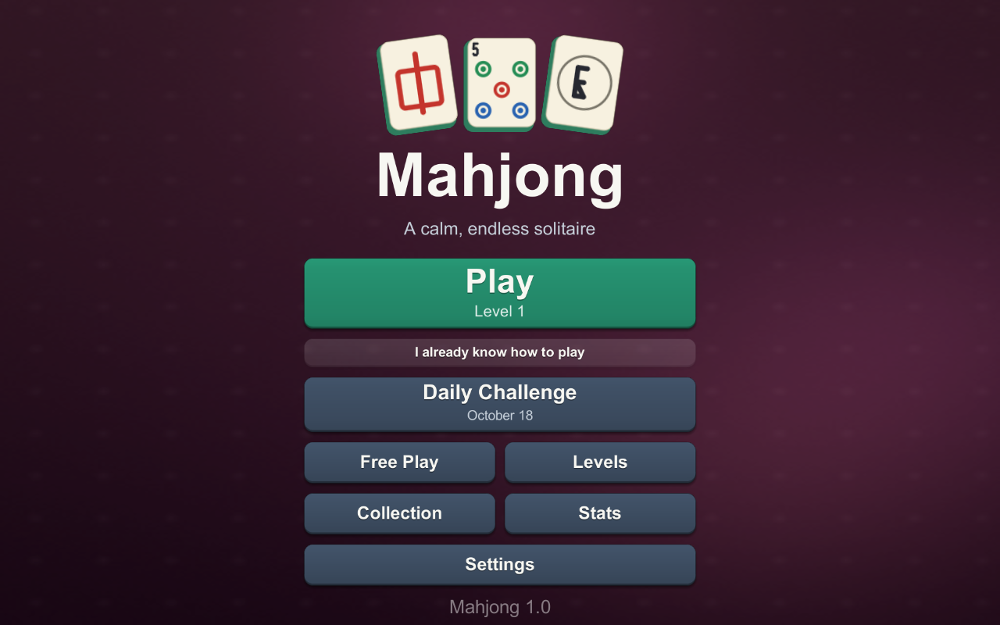
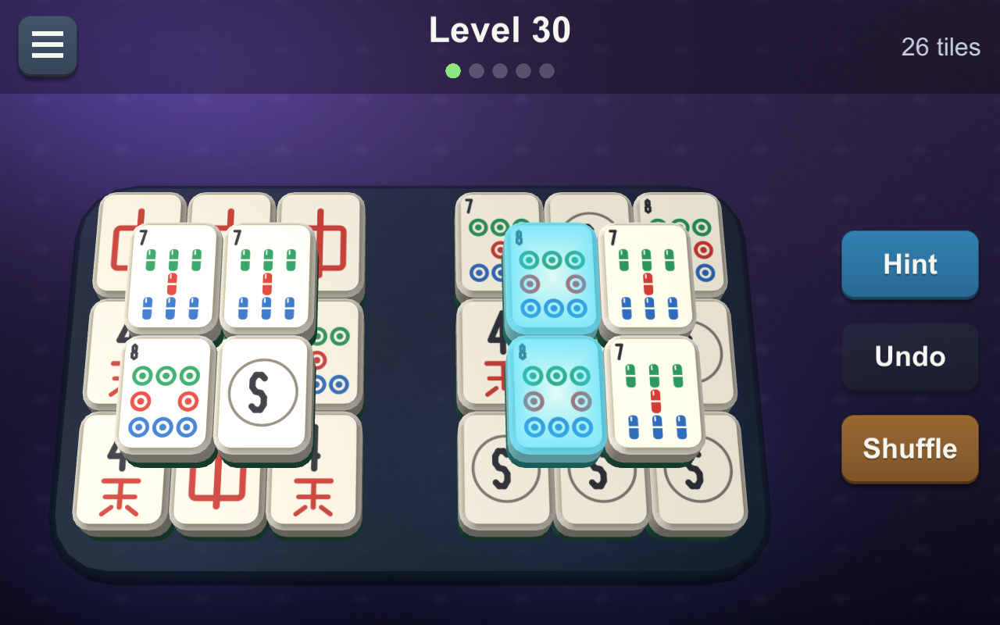
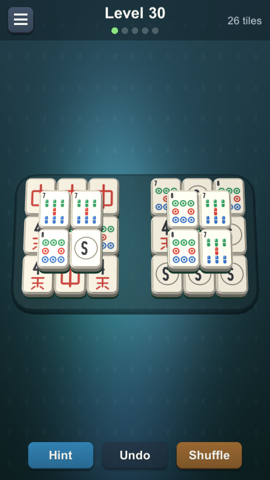

# Mahjong

<p align="center">
  
</p>

**A calm, endless Mahjong Solitaire game for Windows and Android. Free, open source, and yours to improve.**

| | |
|---|---|
| **100% local** | Runs entirely on your device. No servers, no accounts, no sign-in, no internet needed. The project contains no networking code. |
| **No ads** | None. Not now, not "after level 10". |
| **No costs** | No purchases, no premium tier, no coins or gems, no timers that make you wait. |
| **No tracking** | No analytics, no telemetry. Your progress is a small save file on your own machine. |
| **Fair levels** | Every level is generated from a seed, is guaranteed to be solvable, and is the same for every player. |
| **Open source** | MIT licensed. Read it, fork it, change it, ship your own version. |

<p align="center">
  
  
  
</p>

## Make it better

This is a hobby project and it is far from finished. Please take it and run with it.

- **Fork it** and do whatever you like with your copy. No permission needed.
- **Send changes back** with a pull request if you want them in this version. Every change to `main` is reviewed by the maintainer before it is merged, and nothing is pushed here directly by anyone else.
- Ideas that would help most (see [docs/IMPLEMENTATION_NOTES.md](docs/IMPLEMENTATION_NOTES.md) for the full list):
  - More tile layouts. 11 are drawn today; the plan was 24. Each is a few lines of ASCII art in `LayoutLibrary.cs`.
  - Keyboard navigation and screen-reader support.
  - Haptics, more languages, more tile sets and backgrounds.
  - Testing on real Android devices, and on Linux and macOS, to confirm levels generate identically everywhere.
- Before you change generation code, read the [determinism rules](#determinism-rules-do-not-break-these) and run the core tests.

Unity version: **6000.6.4f1**. All art and audio are drawn and synthesised in code, so there are no imported assets.

## Play it

- Windows: run `Builds\Windows\Mahjong.exe` (after building, see below).
- Android: `Builds\Android\Mahjong.apk` (64-bit ARM, minimum Android 8). Built, not yet tried on a physical device.
- In the editor: open the project and press Play. The scene is intentionally empty; the game builds itself at startup.

### Controls

| Action | Mouse / keyboard | Touch |
|---|---|---|
| Select / match | Click two matching free tiles | Tap |
| Hint / Undo / Shuffle | `H` / `Z` / `S` or the buttons | Buttons |
| Restart level | `R` | Pause menu |
| Pause | `Esc` | Menu button, Android Back |
| Pan / zoom (Large or Extra large tile size) | Drag / mouse wheel | Drag / pinch |
| Fullscreen | `F11` or `Alt+Enter` | |

Hidden debug tools: tap the version label on the Home screen 7 times. This unlocks every level in the Levels screen and shows generator stats on the game screen.

## Build and test

Everything below runs headless from PowerShell.

```powershell
# 1. Core logic tests (pure C#, no Unity needed): rules, generator, shuffle, solver, determinism
cd tools\CoreTests
dotnet build -c Release
dotnet bin\Release\net9.0\CoreTests.dll tests
dotnet bin\Release\net9.0\CoreTests.dll golden check golden   # 1000 levels must match the golden file
dotnet bin\Release\net9.0\CoreTests.dll show 400              # ASCII render of a level
dotnet bin\Release\net9.0\CoreTests.dll stats 6 2000          # target vs rated difficulty histogram
dotnet bin\Release\net9.0\CoreTests.dll bench                 # hint latency

# 2. Build the Windows player and drive it with the in-engine autotest (plays real levels by tapping)
powershell -File tools\build_and_test.ps1

# 3. Real mouse and keyboard input against the built player, with screenshots
powershell -File tools\ui.ps1 launch
powershell -File tools\ui.ps1 click 640 365
powershell -File tools\ui.ps1 shot name
powershell -File tools\ui.ps1 kill

# Android APK
Unity.exe -batchmode -nographics -quit -projectPath . -executeMethod Mahjong.EditorTools.BuildScript.BuildAndroid -logFile android.log
```

## How it is put together

```
Assets/_Project/
  Core/      Mahjong.Core      pure C# (no UnityEngine): rules, deterministic RNG, layouts, level generator,
                               rater, shuffle, hint solver, game session. Also compiled by tools/CoreTests.
  Game/      Mahjong.Game      everything Unity: board view, uGUI screens, procedural art and audio, save data
  Editor/    Mahjong.Editor    project setup, icon, build entry points
tools/CoreTests/               .NET console harness that compiles the same Core sources
docs/specs/                    MRD, PRD, TRD and research from the planning phase
docs/IMPLEMENTATION_NOTES.md   what was built versus the specs
```

### Level generation in one paragraph

Level N is seeded from a fixed world seed and N. A layout is picked (11 hand-drawn silhouettes plus 4 procedural families), a full legal clearing sequence is found by a randomised backtracking search on the empty layout, then tile kinds are assigned to the steps of that sequence. Because the sequence is legal by construction, a solution always exists, and the generator replays it as a proof before accepting a board. A difficulty rater (greedy-play simulations plus structure) then scores the board, and the generator re-rolls deterministically until the score is within one point of the target for that level.

### Determinism rules (do not break these)

Inside `Core`: no `System.Random`, no floating point in anything that affects output, no iteration over hash sets or dictionaries where order matters, no `DateTime`, no string `GetHashCode`. Any change that alters generated boards must bump `DifficultyConfig.GeneratorVersion` and regenerate `tools/CoreTests/golden/`. The golden test fails otherwise.
